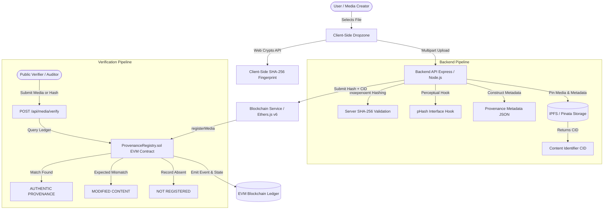

# Deepfake Shield — Decentralized Media Provenance Pipeline

[](https://opensource.org/licenses/MIT)
[](https://soliditylang.org/)
[](https://nodejs.org/)
[](https://nextjs.org/)

**Deepfake Shield** is a production-grade decentralized media authenticity and provenance verification pipeline. It solves the critical media integrity crisis by binding media byte fingerprints to immutable smart contract records on EVM-compatible blockchains, linked with metadata bundles preserved on the InterPlanetary File System (IPFS).

---

## 1. Product Overview & Architecture

### The Core Flow


### The Three-Tier Trust Model

Deepfake Shield explicitly establishes clear boundaries regarding cryptographic guarantees:

1. **Cryptographic Integrity (Byte-Level SHA-256)**:
   Mathematically guarantees that every single bit of the file matches the exact file registered. A change of one pixel or audio millisecond triggers the avalanche effect, producing a different hash.
2. **On-Chain Provenance (Decentralized Ledger)**:
   Binds the cryptographic fingerprint to an authenticated creator wallet address and an immutable consensus block timestamp that cannot be backdated or erased.
3. **Perceptual Analysis (pHash Extensibility)**:
   An isolated interface hook designed to evaluate perceptual similarity (DCT / visual distance) across benign operations such as re-compression, resizing, or format shifts.

> **Important**: Cryptographic provenance verifies **authenticity and origin**—it does not claim that a mathematical hash alone can "detect AI". Rather, it proves whether media has been modified since it was anchored by a trusted entity.

---

## 2. Directory Structure

```text
Deepfake Shiled/
├── contracts/                        # Smart Contract Package (Hardhat + Solidity)
│   ├── contracts/
│   │   └── ProvenanceRegistry.sol    # Core Registry Contract (Ownable, ReentrancyGuard)
│   ├── scripts/
│   │   └── deploy.ts                 # Hardhat deployment script
│   ├── test/
│   │   └── ProvenanceRegistry.test.ts # Comprehensive contract tests (12 passing tests)
│   ├── hardhat.config.ts             # Hardhat network & compiler configuration
│   ├── package.json
│   ├── tsconfig.json
│   └── .env.example
│
├── backend/                          # Backend Service (Node.js, Express, TypeScript)
│   ├── src/
│   │   ├── config/env.ts             # Typed environment configuration
│   │   ├── controllers/              # Media and Verification route controllers
│   │   ├── middleware/               # Upload validation and global error handling
│   │   ├── routes/                   # REST API routes (/api/media, /api/verification)
│   │   ├── services/
│   │   │   ├── hashing.service.ts    # SHA-256 and pHash interface hook
│   │   │   ├── ipfs.service.ts       # Pinata & local offline storage provider
│   │   │   ├── blockchain.service.ts # Ethers.js v6 EVM interaction service
│   │   │   └── provenance.service.ts # Orchestration pipeline
│   │   ├── types/provenance.ts       # Shared TypeScript schemas
│   │   ├── utils/logger.ts           # Safe structured logger (auto-redaction)
│   │   ├── app.ts                    # Express application factory
│   │   └── server.ts                 # Server entrypoint
│   ├── test/                         # Unit & Integration tests (Vitest)
│   ├── package.json
│   ├── tsconfig.json
│   └── .env.example
│
├── frontend/                         # Frontend Dashboard (Next.js 14, Tailwind, Wagmi)
│   ├── app/
│   │   ├── layout.tsx                # Root layout with Web3 & styling providers
│   │   ├── globals.css               # Cybersecurity dark theme
│   │   ├── page.tsx                  # Landing dashboard & trust model
│   │   ├── register/page.tsx         # Media registration workflow
│   │   └── verify/page.tsx           # Verification & audit workflow
│   ├── components/
│   │   ├── FileDropzone.tsx          # Drag-and-drop with instant Web Crypto hashing
│   │   ├── HashDisplay.tsx           # Monospace hash viewer with copy feedback
│   │   ├── VerificationStatus.tsx    # AUTHENTIC / MODIFIED / NOT_REGISTERED states
│   │   ├── ProvenanceCard.tsx        # Provenance certificate card
│   │   ├── WalletConnect.tsx         # RainbowKit Web3 connect button
│   │   ├── TransactionStatus.tsx     # Real-time multi-step pipeline status
│   │   ├── Navbar.tsx
│   │   ├── Footer.tsx
│   │   └── Providers.tsx             # Wagmi & React Query provider wrapper
│   ├── lib/
│   │   ├── api.ts                    # REST client for backend communication
│   │   ├── hashing.ts                # Client-side Web Crypto API hashing
│   │   ├── wagmi.ts                  # Wagmi v2 & RainbowKit config
│   │   └── abi.ts                    # ProvenanceRegistry ABI
│   ├── package.json
│   └── .env.example
│
├── docker-compose.yml                # Multi-service local Docker orchestration
├── .gitignore                        # Universal multi-package gitignore
├── README.md                         # Comprehensive documentation
└── package.json                      # Root workspace orchestrator
```

---

## 3. Technology Stack

- **Smart Contract**: Solidity `^0.8.20`, OpenZeppelin Contracts v5, Hardhat, Ethers.js v6, Paris EVM target.
- **Backend**: Node.js v20+, TypeScript, Express, Helmet, CORS, Express-Rate-Limit, Multer, Form-Data, Axios, Vitest, Supertest.
- **Decentralized Storage**: Pinata Cloud IPFS API + Deterministic Local Provider fallback for offline testing.
- **Frontend**: Next.js 14 (App Router), React 18, TypeScript, Tailwind CSS, Wagmi v2, Viem, RainbowKit, Lucide React.
- **Cryptography**: Client-side `crypto.subtle.digest('SHA-256')`, Server-side `crypto.createHash('sha256')`.

---

## 4. Quickstart Guide

### Prerequisites
- Node.js v20+ or v24+
- npm v10+ or v11+
- Git

### 1. Install All Dependencies
From the repository root:
```bash
# Install root, contracts, backend, and frontend packages
npm install --prefix contracts
npm install --prefix backend
npm install --prefix frontend
```

### 2. Configure Environment Variables
Copy sample environment files:
```bash
cp contracts/.env.example contracts/.env
cp backend/.env.example backend/.env
cp frontend/.env.example frontend/.env.local
```

### 3. Compile and Test Smart Contracts
```bash
cd contracts
npx hardhat compile
npx hardhat test
```
*All 12 unit tests will execute against an in-memory Paris EVM instance.*

### 4. Run Smart Contract Locally
In a dedicated terminal:
```bash
cd contracts
npx hardhat node
```
In another terminal, deploy `ProvenanceRegistry.sol`:
```bash
cd contracts
npx hardhat run scripts/deploy.ts --network localhost
```
*Note the deployed contract address (typically `0x5FbDB2315678afecb367f032d93F642f64180aa3`).*

### 5. Start Backend Service
```bash
cd backend
npm run test    # Run all 17 Vitest tests
npm run dev     # Starts backend API on http://localhost:5000
```

### 6. Start Frontend Dashboard
```bash
cd frontend
npm run dev     # Starts Next.js dashboard on http://localhost:3000
```

Open [http://localhost:3000](http://localhost:3000) in your browser.

### 7. Python Virtual Environment & Forensics Toolkit
The repository includes an isolated Python virtual environment (`.venv`) for media forensics and perceptual hashing (pHash, aHash, dHash):

```powershell
# Activate virtual environment (Windows PowerShell)
.\.venv\Scripts\Activate.ps1

# (Or Command Prompt: .\.venv\Scripts\activate.bat)
# (Or Linux/macOS: source .venv/bin/activate)

# Run the media forensics test suite
python forensics/test_forensics.py

# Analyze a single media file (SHA-256 + pHash)
python forensics/analyze.py --file path/to/image.png

# Compare two media files to detect manipulation or tampering
python forensics/analyze.py --compare path/to/original.png path/to/suspect.png
```

---

## 5. API Reference

### Health Check
`GET /api/health`
Returns service availability, timestamp, and registry status.

### Hash Media File
`POST /api/media/hash`
- **Content-Type**: `multipart/form-data`
- **Body**: `file` (binary)
- **Response**:
```json
{
  "success": true,
  "data": {
    "algorithm": "SHA-256",
    "hash": "0x4e07408562bedb8b60ce05c1decfe3ad16b72230967de01f640b7e4729b49fce",
    "rawHash": "4e07408562bedb8b60ce05c1decfe3ad16b72230967de01f640b7e4729b49fce",
    "size": 1048576,
    "filename": "news_broadcast.mp4",
    "mimeType": "video/mp4"
  }
}
```

### Register Media Provenance
`POST /api/media/register`
- **Content-Type**: `multipart/form-data`
- **Body**: `file` (binary), `creator` (optional string)
- **Response**:
```json
{
  "success": true,
  "data": {
    "status": "REGISTERED",
    "hash": "0x4e07408562bedb8b60ce05c1decfe3ad16b72230967de01f640b7e4729b49fce",
    "ipfsCID": "bafybeihshield...",
    "transactionHash": "0x7a8b9c...",
    "blockNumber": 12,
    "contractAddress": "0x5FbDB2315678afecb367f032d93F642f64180aa3",
    "metadata": { ... }
  }
}
```

### Verify Media Provenance
`POST /api/media/verify`
- **Content-Type**: `multipart/form-data` OR `application/json`
- **Body (Multipart)**: `file` (binary), `expectedHash` (optional string)
- **Body (JSON)**: `{ "hash": "0x...", "expectedHash": "0x..." }`
- **Response**:
```json
{
  "success": true,
  "data": {
    "status": "AUTHENTIC",
    "hash": "0x4e07408562bedb8b60ce05c1decfe3ad16b72230967de01f640b7e4729b49fce",
    "message": "This file matches a registered on-chain provenance record.",
    "record": {
      "creator": "0xf39Fd6e51aad88F6F4ce6aB8827279cffFb92266",
      "timestamp": 1727632800,
      "ipfsCID": "bafybeihshield...",
      "isVerified": true,
      "formattedDate": "Tue, 29 Sep 2026 18:00:00 GMT"
    }
  }
}
```

---

## 6. Docker Deployment

Deepfake Shield includes a complete `docker-compose.yml` configured for zero-friction containerized orchestration:

```bash
docker-compose up --build
```
This boots:
1. `deepfake-shield-node`: Local EVM node on port `8545`.
2. `deepfake-shield-backend`: Node.js Express server on port `5000`.
3. `deepfake-shield-frontend`: Next.js web application on port `3000`.

---

## 7. Security Hardening

- **Private Key Isolation**: Private keys are strictly confined to backend `.env` and deployment scripts; never exposed to the client bundle.
- **Client-Side Verification**: Media hashes can be previewed client-side before submission.
- **Authoritative Server Hashing**: The backend independently re-hashes uploaded files using Node's crypto library before anchoring.
- **Untrusted File Sanitization**: Filenames are sanitized, file size is capped (50MB default), MIME types are strictly whitelisted, and in-memory streams prevent malicious filesystem execution.
- **Smart Contract Protections**: Uses OpenZeppelin v5 `Ownable` and `ReentrancyGuard`, custom errors, and Checks-Effects-Interactions pattern.

---

## 8. License

MIT License. Designed and engineered for high-integrity decentralized media provenance.
